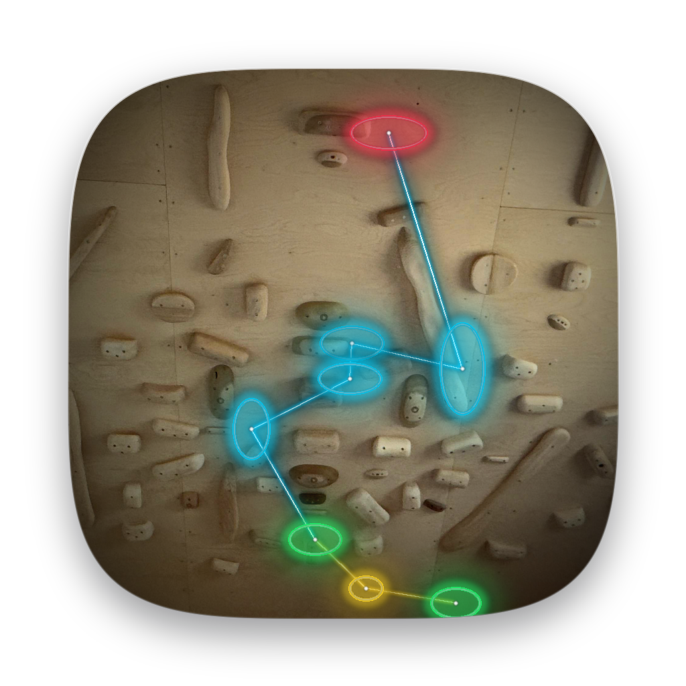
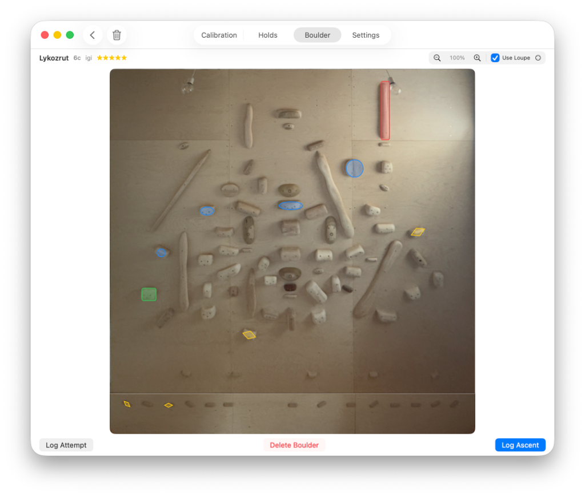

# SprayWall

<p align="center">
  
</p>

<p align="center">
  <strong>Homography Rectification, Geometric Hold Mapping & Boulder Setter for Climbing Spray Walls</strong>
</p>

<p align="center">
  
  
  
  
  
</p>

---

<p align="center">
  
</p>

---

## Overview

**SprayWall** is a native macOS and iOS application for climbing spray walls. It transforms perspective-distorted wall photos into calibrated 2D climbing canvases. 

Setters and climbers can map physical holds as rotatable ellipses, inspect holds using a projective magnifying loupe, define boulders with role color-coding, track ascents, and filter problems by difficulty.

---

## Key Features

### 📐 Geometric Wall Calibration & Image Rectification
- **8-Point Perspective Calibration**: Maps raw photo coordinates to real-world centimeters across multi-angle wall structures (inclined main wall and 90° kickboard).
- **Loupe-Assisted Placement**: Interactive calibration editor with magnifying loupe, coordinate inspection, and edge-aware cropping.
- **Joint-Point Synchronization**: Single-toggle joint adjustment for shared seam boundary points between the kickboard and main wall.
- **Planar Homography Pipeline**: Perspective correction engine outputting rectified PNGs (`main_wall_rectified.png` and `kickboard_rectified.png`).
- **Photo Import**: Import wall photos from the **Apple Photos Library** or the **Computer Filesystem** (`.jpg`, `.jpeg`, `.png`, `.heic`, `.dng`).

### 🎯 Parametric Hold Modeling & Interactive Editing
- **Ellipse Geometry**: Holds are modeled with major axis ($cm$), minor axis ($cm$), and planar rotation angle ($^\circ$).
- **Direct Manipulation**:
  - **Normal Drag**: Moves the hold's central bolt-hole position.
  - **Shift + Drag**: Activates visual axis handles for resizing and rotation.
- **Scale-Invariant Line Rendering**: Marker lines and handles maintain a constant on-screen stroke width ($1.2\text{ pt} / \text{zoomScale}$), avoiding visual clutter when zooming into dense hold clusters.
- **Side-Positioned Loupe**: The magnifying loupe automatically docks to the opposite screen gutter during hold editing, keeping visual handles and holds visible.

### 🔍 Projective Backward Homography Loupe
- **Perspective-Corrected Loupe Projection**: Projects the hold's physical planar geometry through the camera homography matrix, aligning the hold ellipse and rotated bounding box with the tilted perspective photo.
- **Multiple Loupe Geometries**: Configurable circle and rounded rectangle loupe shapes with edge clamping and zoom levels.
- **Hover Feedback**: Hover highlighting across all holds, operating with the loupe enabled or disabled.

### 🧗 Boulder Definition & Tick List
- **Standardized Hold Roles & Color Hierarchy**:
  | Role | Shape | Idle Outline | Hover Accent |
  | :--- | :--- | :--- | :--- |
  | **Start** | Rounded Rectangle | Green (`Color.green`) | Cyan Halo + Thickened Stroke |
  | **Top** | Rounded Rectangle | Red (`Color.red`) | Cyan Halo + Thickened Stroke |
  | **Handhold** | Ellipse | Blue (`Color.blue`) | Cyan Halo + Thickened Stroke |
  | **Foothold** | Diamond | Yellow (`Color.yellow`) | Cyan Halo + Thickened Stroke |
  | **Unselected** | Ellipse | White (`Color.white.opacity(0.55)`) | Cyan (`Color.cyan`) |
- **Rotated Bounding Box Symbols**: Holds in the boulder view are rendered with symbols oriented inside the hold's physical bounding box.
- **Draft & Established States**: Separates editable drafts from established boulders.
- **Grade Filtering & Ascent Logging**: Grade range slider filter, 5-star quality ratings, setter attribution, and ascent logging.

### 🔒 Security, Reliability & Persistence
- **SwiftData SQLite Storage**: Relational local database tracking holds, grips, boulders, routes, ascents, and calibrations.
- **Keychain Security**: User authentication and credential management.
- **Project Archives**: JSON export and import for backup and transfer.

---

## Architecture & Technology Stack

| Component | Implementation |
| :--- | :--- |
| **Language** | Swift 6.0 (Strict Concurrency & Sendable compliance) |
| **User Interface** | SwiftUI (Universal macOS & iOS responsive views) |
| **Persistence** | SwiftData backed by SQLite (`wall_project/spraywall.sqlite`) |
| **Computer Vision** | CoreGraphics, Accelerate $vDSP$, ImageIO perspective homography solvers |
| **Build System** | Swift Package Manager + Ruby native Xcode project generator (`xcodeproj`) |

---

## Getting Started

### Prerequisites
- **macOS**: Sonoma 14.0 or newer
- **iOS**: iOS 17.0 or newer (for mobile deployments)
- **Xcode**: 16.0 or newer (with Swift 6 compiler toolchain)

### Build & Run via Swift Package Manager

```bash
# Clone the repository
git clone https://github.com/igorcerovsky/spray_wall.git
cd spray_wall

# Run automated test suite (37 unit tests)
swift test

# Build debug or release executable
swift build -c release
```

### Xcode Project Generation

The repository includes an automated Ruby generator that configures a native, multi-target Xcode project (`SprayWall.xcodeproj`) supporting macOS and iOS:

```bash
# Generate the Xcode project
ruby Tools/generate_xcodeproj.rb

# Build and verify with xcodebuild
xcodebuild -project SprayWall.xcodeproj -scheme SprayWall-macOS -configuration Debug build
```

---

## Default Physical Wall Specifications

SprayWall is pre-configured for standard multi-pitch home and gym boards, with customizable world coordinates:

| Parameter | Default Value | Notes |
| :--- | :--- | :--- |
| **Wall Width** | $360\text{ cm}$ | Measured horizontally across boards |
| **Main Wall Height** | $320\text{ cm}$ | Sloped overhang section |
| **Main Wall Angle** | $40^\circ$ | Measured from floor |
| **Kickboard Height** | $40\text{ cm}$ | Vertical base panel |
| **Kickboard Angle** | $90^\circ$ | Perpendicular to floor |
| **Default Coordinate Origin** | $(0, 0)$ | Bottom-left corner of the kickboard |

---

## Directory Structure

```text
spray_wall/
├── Package.swift                    # Swift Package definition (macOS & iOS targets)
├── Sources/SprayWall/
│   ├── App/                         # App lifecycle, navigation, environment models
│   ├── Models/                      # SwiftData domain models (Hold, Boulder, Calibration)
│   ├── Services/                    # Homography math, image rectification, auth, migration
│   ├── Utilities/                   # Coordinate transformations, path resolution, codecs
│   └── Views/
│       ├── Calibration/             # Interactive 8-point rectification & photo import
│       ├── Holds/                   # Hold canvas, Shift-drag ellipse geometry editor
│       ├── Boulders/                # Boulder setter, role styling, grade filtering
│       └── Shared/                  # Scaled background, projective loupe, zoom controls
├── Tests/SprayWallTests/            # Comprehensive unit & regression test suites
├── Tools/                           # Ruby Xcode project generator and maintenance scripts
├── resources/                       # Default calibration photo and icon assets
└── docs/                            # Documentation assets and screenshots
```

---

## Testing

SprayWall maintains a unit test suite covering geometric transformations, numerical precision, and persistence:

```bash
swift test
```

Test coverage includes:
- **Square-to-Quad & Quad-to-Square Projective Mapping**
- **Perspective Image Rectification Pipeline**
- **Spatial Hit-Testing & Focal Zoom Inversion**
- **Hold Ellipse Modeling & Bounding Box Rotations**
- **Homography-Based Loupe Geometry Projection**
- **CSV and JSON Migration Resilience**

---

## License

This project is proprietary and developed by Igor Cerovsky. All rights reserved.
